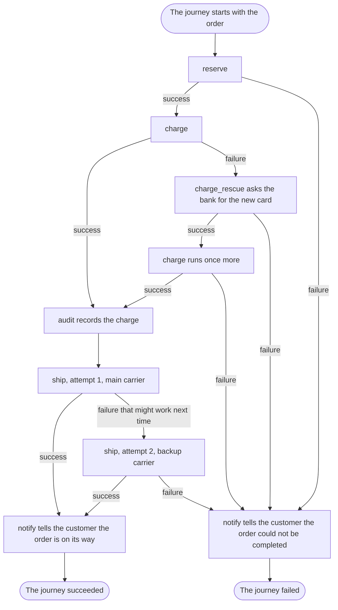

# Read the workflow, know what happens

## What you want to do

You want to answer the questions of [chapter 1](01-the-hardest-part-is-knowing-what-is-going-on.md) about the shop: in what order the work happens, how many times the card is charged, what happens when a carrier cannot take a parcel, what is audited and who is told. This time you answer them by reading one thing: the shop's workflow.

## The code

This is the whole shop's workflow. Its steps are written much as you would expect from [chapter 2](02-steps-policies-and-workflows.md); what matters here is the declaration.

```example
name: ch03_shop
region: workflow
```

The steps talk to the bank, the warehouse and the carriers through **services**: objects a step asks for by a key, such as `payments`, and uses without knowing which implementation it got. The workflow supplies each one through a **provider**, which also decides how long an instance lasts: one for the whole journey, or a fresh one for every attempt.

```example
name: ch03_shop
region: providers
```

```note
name: ch03_shop
```

## How it works

Read the declaration from top to bottom, and the questions of chapter 1 answer themselves.

1. **In what order does a checkout do its work?** `reserve`, then `charge`, then `ship`: the order of the step lines. A step can skip itself and a policy can end the journey early, but nothing can reorder the steps or jump between them.
2. **How many times is the card charged?** At most twice. The `charge` step has no retry budget, so it is never simply tried again. It has a **rescue step** instead, `RenewCard`. When the charge fails, Itinera runs the rescue step under the name `charge_rescue`. It reads why the charge failed, and only when the reason is `expired-card` does it ask the bank for the new card and contribute it as `card`. Then the charge runs once more, with the new card. For any other reason the rescue fails, and so does the journey.
3. **What happens when the card is declined twice?** That is Dan's order: the card has expired, the rescue gets the new card, and the bank refuses the new card too. A rescued step runs at most twice, so its second failure fails the journey. The charge never runs a third time.
4. **What happens when the main carrier cannot take the parcel?** The `ship` step has a retry budget of 1, so it may be tried twice in all. When the carrier cannot take the parcel, the step fails in a way that might work next time, with the reason `carrier-unavailable`. The budget allows another attempt, and the `carrier` provider makes a fresh carrier for every attempt: the main carrier on the first, the backup carrier after. The ship step never knows there are two carriers. If the second attempt fails too, the journey fails, because the retries are exhausted.
5. **Is every successful charge audited?** The `audit` policy is attached to `charge`, so its `on step success` hook runs after every successful attempt of the charge, including the one after a rescue.
6. **Which policy decides what happens after a failure?** None of the shop's policies defines `on step failure`, so no policy changes the default: a step that fails, after its retries or its rescue, fails the journey. The absence is part of what you read.
7. **When is the customer told?** The `notify` policy is attached to the workflow itself. When the journey ends, its `on workflow success` hook or its `on workflow failure` hook runs, once, and tells the customer through `Messages`, a **role**: an interface of operations that the workflow provides to policies, here `tell`.

The providers answer the questions about the outside world. One payment client serves the whole journey, shared by the charge and its rescue step. One stock store serves the whole journey, shared by `reserve` and `ship`. Every attempt of `ship` gets a carrier of its own, chosen from the attempt number.

Compare that with chapter 1, where each answer meant following calls through modules. Here every decision about the flow is in the declaration, or is a default that applies because the declaration says nothing.

The diagram follows one journey through the shop, from the order's data to the end.



The diagram shows:

1. The journey starts with the order's data and runs `reserve`. If reserving fails, the journey goes to its end as failed.
2. Then `charge` runs. When it succeeds, the `audit` policy records the charge.
3. When the charge fails, the rescue step `charge_rescue` runs and asks the bank for the new card. If the rescue fails, the journey goes to its end as failed.
4. When the rescue succeeds, the charge runs once more. If it succeeds, `audit` records it; if it fails, the journey goes to its end as failed.
5. After the audit, `ship` makes its first attempt, with the main carrier. If it succeeds, the journey goes to its end as succeeded.
6. If the first attempt fails in a way that might work next time, `ship` makes a second attempt, with the backup carrier. If that succeeds, the journey goes to its end as succeeded; if it fails, the journey goes to its end as failed.
7. At a successful end, `notify` tells the customer the order is on its way, and the journey succeeded.
8. At a failed end, `notify` tells the customer the order could not be completed, and the journey failed.

## Remember

1. The steps run in the order of the declaration, and nothing else changes it.
2. A step is tried again only within its retry budget. A step with a rescue step has no retry budget, and runs at most twice.
3. A hook that no attached policy defines keeps its default: a step that fails, once its retries or its rescue are spent, fails the journey.
4. What a step does is in the step; what happens around it is in the workflow and its policies, and nowhere else.
