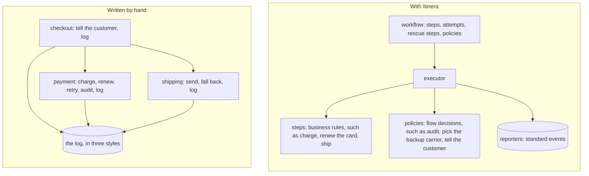

# Welcome to Itinera

Hi, and welcome. We're glad you're here.

This book is about Itinera, a workflow framework that keeps the rules of your business apart from the decisions about what happens around them. We wrote it for people who build software for others, and for the AI agents who build it with them. You don't need to know anything about workflows to read it. You only need to know the programming language you build with.

Before any code, let us tell you what Itinera is, where its name comes from, and what we are trying to change.

## What we are trying to change

Think about the last piece of business code you read that charged a card, called a carrier or sent a message. Somewhere in it, there was a decision that had nothing to do with the business: try again if the bank times out, fall back to the other carrier, give up after three attempts, log this, tell the customer that. Those are flow decisions. They decide what happens around the work, not what the work is.

Flow decisions usually live inside the business code, because that is where the failure shows up. Each one is reasonable on its own. Together, they mean that the only way to know what your system does with an order is to read every function the order passes through, and hope you don't miss one. Good habits such as clean modules and dependency injection don't fix this. They separate a piece of code from the things it uses, but not from what happens to it when it fails.

We think there is a better place for those decisions: one place, which you can read from top to bottom, and which tells you what will run, in what order, how many times, and what happens when something goes wrong.

## What Itinera is

Itinera gives every kind of decision a place of its own:

1. **A step** holds one business rule, such as "charge the order its price, less any discount". It asks for the data it needs, contributes the data it produces, and reports how it went. It never knows what comes before it or after it.
2. **A workflow** lists the steps in the order they run, how many times each may be tried again, and the policies attached to them. Read it, and you know what will run.
3. **A policy** holds the flow decisions. After each outcome, the executor calls the policy's hooks, and they decide what happens next: carry on, perhaps changing the data the next attempt will use, finish the journey early, or fail it.
4. **The executor** runs a workflow instance, one for each order, and reports everything it does as events, the same way for every workflow you write.

That's all. There is no branching inside a workflow, no hidden retries, and nothing a step can call to change what comes next. Itinera makes the separation part of the structure, so it no longer depends on everyone's discipline.

## What you get

Separating the decisions is not only tidier. Because the executor carries out every decision itself, everything around your business code becomes standard.

1. **You always know what is going on.** Every journey reports what happens as events, in the same form and the same order, whatever the workflow does and whoever wrote its steps. You never depend on what someone thought worth logging: one reporter tells you the whole story of every workflow you have.
2. **A step is a business rule, by design.** A step doesn't know who runs it, which workflow it belongs to, which journey it is part of, what came before it, what comes after, or whether it will be tried again. It gets its data, does its work and says how it went. With nothing else to reach, a step cannot decide anything about the flow: what it holds is its business rule, so you can read it, test it and change it on its own.
3. **Every flow decision is in plain sight.** Trying again, repairing, falling back, auditing, telling the customer, giving up: each is declared in the workflow, as a step's retry budget, its rescue step, or a policy attached to a step or to the workflow. Look at the workflow, and you see at a glance everything that can happen to every step.

Here is the same shop both ways. On the left, written by hand: each function mixes its business rule with flow decisions and its own logging. On the right, with Itinera: each concern has one place, and the executor connects them.

Written by hand:

1. The checkout calls the payment and shipping functions, then tells the customer how it went and logs any failure.
2. The payment function charges the card, but also renews an expired card and charges again, audits the charge and logs the renewal.
3. The shipping function sends the parcel, but also falls back to the backup carrier and logs the switch.
4. Each of the three writes to the log, each in its own way, saying only what its author chose.

With Itinera:

1. The workflow lists the steps in order, how many attempts each has, and which rescue step and policies are attached.
2. The executor reads the workflow and carries out every decision.
3. It runs the steps, which hold business rules, such as charging the card, renewing the card and shipping the parcel.
4. After each outcome, and when the journey ends, it calls the policies, which hold flow decisions, such as auditing the charge, picking the backup carrier and telling the customer.
5. It sends every event of every journey to the reporters, in one standard form.

Itinera is also more than one library. Its behaviour is defined once, in a [specification](https://github.com/itinera-dev/spec) that names no programming language, and each language's implementation is checked against the same conformance suite. A workflow means the same thing in every language, and so does this book.

## Where the name comes from

*Itinera* is Latin. It is the plural of *iter*, which means a journey, a route, the way from one place to another. It is where the word "itinerary" comes from.

That is exactly what Itinera runs. One execution of a workflow for one order is a **journey**: it starts with what you know about the order, passes through the steps in order, and ends with what happened. One workflow, many journeys: *itinera*.

## How this book is laid out

The book follows one small online shop from start to finish. It charges orders, ships them through a carrier, falls back to another carrier when the first one fails, audits every successful charge, and tells customers how their order went. The shop grows a little in every chapter.

1. Before Part 1 come three short pages: this welcome, [how to read this book](how-to-read-this-book.md), and a [quick start](quick-start.md) that shows a whole workflow on one page.
2. **Part 1, Introduction,** asks why you would want Itinera at all, then gives you the few ideas it is built on.
3. **Part 2, Getting started,** installs Itinera and builds the shop's first workflow.
4. **Part 3, Writing steps,** is about the business code: what a step needs, what it passes on and how it says what happened.
5. **Part 4, Controlling the flow,** is about everything around it: trying again, repairing, reacting, ending early and telling the outside world.
6. **Part 5, Running it for real,** runs many journeys, reads their results, watches their events and tests the workflows.
7. **Part 6, Designing with Itinera,** helps you decide where each piece of your own code belongs.
8. **The appendices** hold a cheat sheet, a glossary and what this version supports.

Every part but the last ends with a section called "Without Itinera", which puts the same shop, written the usual way, beside the Itinera version, so you can judge the difference for yourself.

You can read the book from the start, or jump to the chapter you need: every example is a complete program that runs on its own.

Let's begin.
