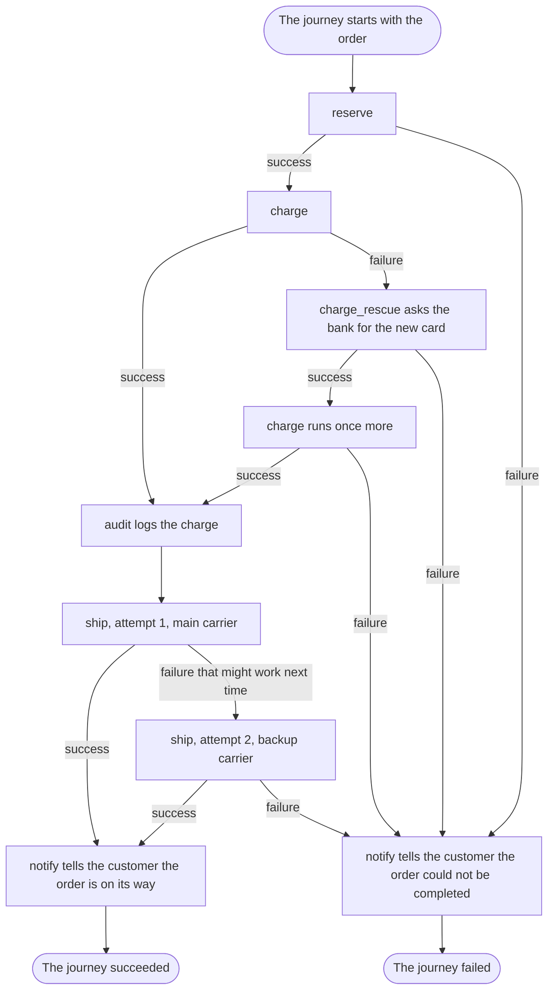

# The big picture

## What you want to do

You want to answer the questions of [chapter 1](01-but-why-itinera.md) about the same checkout: in what order it works, what happens when the card is declined twice or the main carrier cannot take a parcel, what is audited and who is told. This time the checkout is written with Itinera, and you answer from one place.

Each piece is named in a sentence, with a link to the chapter that teaches it. What matters here is where each decision lives.

## The code

The business rules are **steps**. Each holds one rule and nothing else. This is the charge: it charges the card the price, less any discount, and says how it went. It succeeds and records what it charged, or it fails with a reason, `expired-card` or `declined`. It does not know what comes before it or after it, and it does not decide what happens next. [Chapter 6](06-a-workflow-of-one-step.md) teaches steps.

```example
name: ch02_big_picture
region: charge
```

The **workflow** puts the checkout together, as [chapter 6](06-a-workflow-of-one-step.md) teaches. It lists the steps in the order they run, and everything attached to them:

```example
name: ch02_big_picture
region: workflow
```

1. `reserve`, `charge` and `ship` run in that order.
2. `rescue = RenewCard` gives the charge a rescue step, which the workflow names `charge_rescue`: when the charge fails, it may repair what went wrong, and the charge runs once more. [Chapter 14](14-repairing-then-trying-once-more.md) teaches rescue steps.
3. `policies = [Audit]` attaches the `audit` **policy** to the charge, which records every successful charge. A policy holds flow decisions and reactions; one attached to a step runs after each [outcome](10-saying-how-it-went.md) of that step. [Chapter 15](15-reacting-to-what-a-step-did.md) teaches step policies.
4. `retry_budget = 1` lets `ship` be tried once more after a failure that might work next time. [Chapter 13](13-trying-again.md) teaches retries.
5. `policies = [Notify]` attaches the `notify` policy to the workflow itself, so it tells the customer how the order went when the journey ends. [Chapter 17](17-doing-something-when-the-journey-ends.md) teaches it.
6. `reporters = [Log]` attaches the shop's log as a **reporter**, which receives everything that happens. [Chapter 23](23-seeing-what-happened.md) shows how to write one.

The rescue step holds a business rule of its own: it can renew only an expired card, by asking the bank for the new one.

```example
name: ch02_big_picture
region: rescue
```

The steps reach the bank, the warehouse and the carriers through services, which the workflow's providers supply: one bank and one warehouse for the whole journey, and a carrier for every attempt, the main carrier first and the backup carrier after. [Chapter 12](12-giving-a-step-the-tools-it-needs.md) teaches services. They are faked here, as in chapter 1, so the program prints the same thing every time.

```example
name: ch02_big_picture
region: providers
```

Before it runs anything, the program prints the workflow's **listing**: what the declaration says, as data.

```example
name: ch02_big_picture
region: list
```

Then it runs the orders. Ann, Ben, Cat and Dan come from chapter 1, with the same data. Three more customers take the paths none of them takes: Eve's goods are out of stock, Fin's card is valid but his order is above the bank's limit of 1,000, and Gil's parcel weighs 60 kg, too heavy for both carriers.

```example
name: ch02_big_picture
region: orders
```

Each order is a **journey**: one run of the workflow, from its first step to its result, as [chapter 6](06-a-workflow-of-one-step.md) teaches. The program prints the listing, then, under each order, what the log and the customer were told, and how the journey ended:

```output
name: ch02_big_picture
```

## How it works

Here are chapter 1's questions again, answered from the declaration.

1. **In what order does a checkout do its work?** `reserve`, then `charge`, then `ship`: the order of the `#[with_step(...)]` lines. **Nothing reorders the steps or jumps between them.** The only exceptions: a step can [skip itself](10-saying-how-it-went.md), and a policy can [end the journey early](16-ending-a-journey-early.md); no order here does either.
2. **What happens when the card is declined twice?** The charge has a rescue step and no retry budget, so **it runs at most twice**: once, then once more after a successful rescue. That is Dan's order: his card has expired, the rescue gets his new card, the bank declines it because the order is above its limit, and the journey fails. Which failures the rescue can repair is its own business rule, written in `RenewCard`: only `expired-card`. Fin's card is declined for another reason, so the rescue fails with `nothing-to-renew`, and so does his journey.
3. **What happens when the main carrier cannot take the parcel?** `ship` may be tried twice. The ship step only says that a refused parcel might work next time; the workflow's carrier provider gives the second attempt the backup carrier. Cat's parcel goes with it. Gil's is too heavy for both, so his journey fails because the retries are exhausted.
4. **Is every successful charge audited?** `audit` is attached to the charge, so it runs after every successful attempt, including the one after a rescue, as Ben's order shows. Dan's charge never succeeds, so it is never audited.
5. **When is the customer told, and what?** `notify` is attached to the workflow, so it runs once, when the journey ends, and says whether the order is on its way or could not be completed.

None of the shop's policies decides anything after a failure, so the default applies: **a step that fails, once its retries or its rescue are spent, fails the journey.** Eve's order shows it: `reserve` fails and her card is never charged. The absence is part of what you read.

The listing answers some of these questions with no code at all: every step in order, the `audit` policy on the charge, the services and where each comes from, and the charge's rescue step. It is made from the declaration alone, so **the listing can never disagree with the workflow**. A person, a review tool or an agent can read it before any journey runs.

The diagram follows a journey through the shop.



The diagram shows:

1. The journey starts with the order's data and runs `reserve`. If reserving fails, as Eve's does, the journey goes to its end as failed.
2. Then `charge` runs. When it succeeds, as Ann's does, the `audit` policy logs the charge.
3. When the charge fails, the rescue step `charge_rescue` runs and asks the bank for the new card. If the rescue fails, as Fin's does, the journey goes to its end as failed.
4. When the rescue succeeds, the charge runs once more. If it succeeds, as Ben's does, `audit` logs it; if it fails, as Dan's does, the journey goes to its end as failed.
5. After the audit, `ship` makes its first attempt, with the main carrier. If it succeeds, as Ann's does, the journey goes to its end as succeeded.
6. If the first attempt fails in a way that might work next time, `ship` makes a second attempt, with the backup carrier. If that succeeds, as Cat's does, the journey goes to its end as succeeded; if it fails, as Gil's does, the journey goes to its end as failed.
7. At a successful end, `notify` tells the customer the order is on its way, and the journey succeeded.
8. At a failed end, `notify` tells the customer the order could not be completed, and the journey failed.

Itinera fits work like this: steps in a fixed order, with decisions around them. It is not a job queue: a journey runs now, in your process, and returns its result. It is not a diagram language or an engine server: a workflow is Rust code, compiled with the rest of yours. And it never branches: the steps run in the order the workflow lists them.

## Outcomes

We have shown the whole checkout as one workflow, and answered every question of chapter 1 by reading it.

| The usual way | With Itinera |
|---|---|
| Retries, repairs and fallbacks usually live in the functions that meet the failure, so finding them means reading those functions. | Every retry budget, rescue step and policy is in the workflow's declaration, and a missing one means the default. |
| Which services a function uses is often known only from its body or its constructor. | The listing shows every step's services and where each comes from, before anything runs. |
