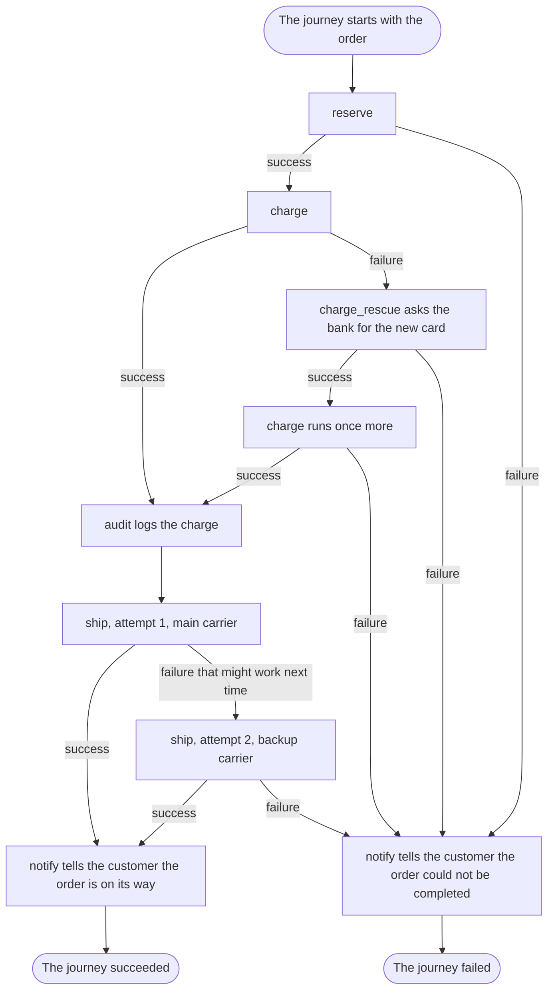

# Read the workflow, know what happens

## What you want to do

You want to answer the questions of [chapter 1](01-but-why-itinera.md) about the shop: in what order the work happens, how many times the card is charged, what happens when a carrier cannot take a parcel, what is audited and who is told. This time you start from one thing: the shop's workflow.

## The code

This is the shop's workflow, doing what chapter 1's checkout does, so the two can be compared; it leaves out chapter 2's review. Its steps are written much as you would expect from [chapter 2](02-steps-policies-and-workflows.md); what matters here is the declaration.

```example
name: ch03_shop
region: workflow
```

A few things in it are new, and each has a chapter of its own later. For now, one sentence each is enough to read the declaration:

1. `retry_budget = 1` lets `ship` be tried once more after a failure that might work next time. [Chapter 13](13-trying-again.md) teaches retries.
2. `rescue = RenewCard` gives the charge a **rescue step**: a step that runs when the charge fails, may repair what went wrong, and lets the charge run once more. [Chapter 14](14-repairing-then-trying-once-more.md) teaches it.
3. `policies = [Audit]` attaches the `audit` step policy to the charge. Like chapter 2's `review`, its hook runs after every successful attempt of the charge; it logs the charge as an event of the journey. [Chapter 15](15-reacting-to-what-a-step-did.md) teaches step policies, and [chapter 23](23-seeing-what-happened.md) the events a hook reports.
4. `policies = [Notify]` attaches the `notify` policy to the workflow itself, so its hooks run when the journey ends, and tell the customer how the order went. [Chapter 17](17-doing-something-when-the-journey-ends.md) teaches it.
5. `reporters = [Log]` sends every event of each journey to `Log`, a **reporter**, which writes the failures, the decisions and the audit to the shop's log. [Chapter 23](23-seeing-what-happened.md) teaches reporters.

The steps reach the bank, the warehouse and the carriers through **services**, which the workflow supplies; [chapter 12](12-giving-a-step-the-tools-it-needs.md) shows how. In this program the bank, the warehouse and the carriers are faked, so it prints the same thing every time it runs, as in chapter 1.

Before it runs anything, the program asks the workflow for its **listing**: what the declaration says, as data. `Orders::descriptor()` gives the workflow's declaration, and its `listing()` gives one entry per step, in order, with the step's policies, the services it asks for and where each comes from, and its rescue step. A small function, `entry`, turns each entry into a line.

```example
name: ch03_shop
region: list
```

The program then runs the four orders of [chapter 1](01-but-why-itinera.md), with the same data, and three more, from Eve, Fin and Gil, so that every path the diagram shows is taken by an order. Each order is the journey's initial data, and the data alone decides which path the journey takes. As in chapter 1, each card ends with the year it expires, and the bank refuses a card that expired before 2026, and any charge above 1,000. The warehouse has nothing left for order A-5:

```example
name: ch03_shop
region: orders
```

Ann's order goes through. Ben's card expired in 2024, so the charge fails; `charge_rescue` gets his new card, and the charge runs once more and succeeds. Cat's parcel weighs 30 kg, more than the 20 kg the main carrier takes, so `ship` makes a second attempt, with the backup carrier, which takes up to 50 kg. Dan's card has expired too, and the rescue gets his new card, but his order of 1,200 is above the bank's limit of 1,000, so the bank declines it and his journey fails with the cause `failure` and the reason `declined`. Eve's order is out of stock, so `reserve` fails and her card is never charged. Fin's card is valid, but his order of 1,500 is above the bank's limit; `charge_rescue` can only renew an expired card, so it fails with `nothing-to-renew`, and so does his journey. Gil's parcel weighs 60 kg, too heavy for both carriers, so the second attempt fails too, and his journey fails with the cause `retries exhausted`.

The program prints the listing first. Then, under each order's number, the shop's log prints every failed attempt, the decision that follows it, a rescue about to run and every audited charge, and `notify` prints its message to the customer; the last line under each order is how the journey ended:

```output
name: ch03_shop
```

## How it works

Read the declaration from top to bottom. It tells you the order of the steps, how many times each may be tried, which step has a rescue step, which policies are attached and where, and, by what it leaves out, which defaults apply. What it leaves to the steps is their own business: whether a failure is worth another attempt, and which failures a rescue step can repair.

1. **In what order does a checkout do its work?** `reserve`, then `charge`, then `ship`: the order of the `#[with_step(...)]` lines. A step can skip itself and a policy can end the journey early, but nothing can reorder the steps or jump between them.
2. **How many times is the card charged?** At most twice. The `charge` step has no retry budget, so it is never simply tried again. It has a rescue step instead. When the charge fails, Itinera runs `RenewCard` under the name `charge_rescue`; if the rescue succeeds, the charge runs once more, with what the rescue contributed. The declaration says that much. Which failures the rescue repairs is the rescue step's own business rule, written in `RenewCard`: only `expired-card`, for which it asks the bank for the new card and contributes it as `card`. For any other reason it fails with `nothing-to-renew`, and so does the journey, as Fin's order shows.
3. **What happens when the card is declined twice?** That is Dan's order: the card has expired, the rescue gets the new card, and the bank declines the new card too, because the order is above its limit. A rescued step runs at most twice, so its second failure fails the journey. The charge never runs a third time.
4. **What happens when the main carrier cannot take the parcel?** The `ship` step has a retry budget of 1, so it may be tried twice in all, and the workflow gives every attempt a carrier of its own: the main carrier on the first, the backup carrier after. Whether a failure is worth another attempt is the ship step's to say: it reports a carrier that cannot take the parcel as a failure that might work next time, `parcel-refused`, and the budget then allows the second attempt. The ship step never knows there are two carriers. If the second attempt fails too, as Gil's does, the journey fails, because the retries are exhausted.
5. **Is every successful charge audited?** The `audit` policy is attached to `charge`, so its `on step success` hook runs after every successful attempt of the charge, including the one after a rescue. Ben's order shows it: his charge is audited after `charge_rescue`, and Dan's, which never succeeds, is not audited at all.
6. **Which policy decides what happens after a failure?** None of the shop's policies defines `on step failure`, so no policy changes the default: a step that fails, after its retries or its rescue, fails the journey. The absence is part of what you read.
7. **When is the customer told?** The `notify` policy is attached to the workflow itself. When the journey ends, its `on workflow success` hook or its `on workflow failure` hook runs, once, unless the journey is aborted, and tells the customer, through an operation the workflow provides to it, which [chapter 18](18-letting-policies-act-on-the-outside-world.md) teaches.

The listing, the first three lines the program prints, answers several of these questions without any code to read: every step in order, the `audit` policy on the charge, where each service comes from, and the charge's rescue step. The retry budgets and the workflow's own policies, such as `notify`, are read in the declaration. It is made from the declaration alone, so it can never disagree with it. A person, a review tool or an agent can read it to know what the workflow does before any journey runs.

Compare that with [chapter 1](01-but-why-itinera.md), where each answer meant following calls through modules. Here every decision about the flow is in the declaration, or is a default that applies because the declaration says nothing. What the steps decide is only their own business, and each of them says it in one place: the ship step that a carrier's refusal is worth another try, the rescue step which failures it can repair.

The diagram follows one journey through the shop, from the order's data to the end.



The diagram shows:

1. The journey starts with the order's data and runs `reserve`. If reserving fails, as Eve's does, the journey goes to its end as failed.
2. Then `charge` runs. When it succeeds, the `audit` policy logs the charge.
3. When the charge fails, the rescue step `charge_rescue` runs and asks the bank for the new card. If the rescue fails, as Fin's does, the journey goes to its end as failed.
4. When the rescue succeeds, the charge runs once more. If it succeeds, as Ben's does, `audit` logs it; if it fails, as Dan's does, the journey goes to its end as failed.
5. After the audit, `ship` makes its first attempt, with the main carrier. If it succeeds, the journey goes to its end as succeeded.
6. If the first attempt fails in a way that might work next time, `ship` makes a second attempt, with the backup carrier. If that succeeds, as Cat's does, the journey goes to its end as succeeded; if it fails, as Gil's does, the journey goes to its end as failed.
7. At a successful end, `notify` tells the customer the order is on its way, and the journey succeeded.
8. At a failed end, `notify` tells the customer the order could not be completed, and the journey failed.

## Remember

1. The steps run in the order of the declaration, and nothing else changes it.
2. A step is tried again only within its retry budget. A step with a rescue step has no retry budget, and runs at most twice.
3. A hook that no attached policy defines keeps its default: a step that fails, once its retries or its rescue are spent, fails the journey.
4. What a step does is in the step; what happens around it is in the workflow and its policies, and nowhere else.
5. The listing is made from the declaration alone, so it shows the steps in order, their step policies, their services and where each comes from, and rescue steps, before any journey runs.
