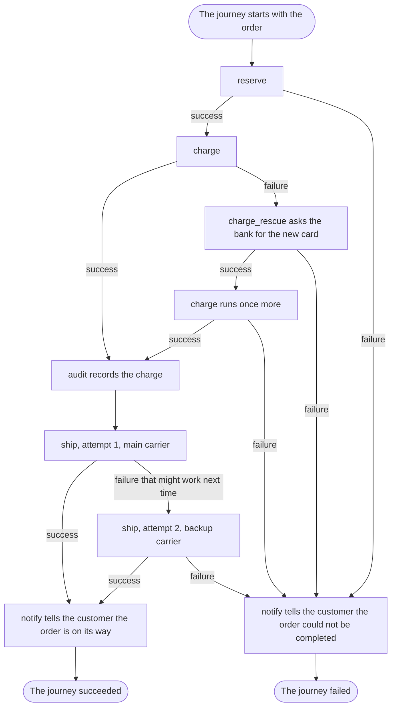

# Read the workflow, know what happens

## What you want to do

You want to answer the questions of [chapter 1](01-but-why-itinera.md) about the shop: in what order the work happens, how many times the card is charged, what happens when a carrier cannot take a parcel, what is audited and who is told. This time you start from one thing: the shop's workflow.

## The code

This is the whole shop's workflow. Its steps are written much as you would expect from [chapter 2](02-steps-policies-and-workflows.md); what matters here is the declaration. `Log` is a **reporter**: a type implementing the `Reporter` trait, which receives everything that happens in a journey and writes the failures and decisions to the shop's log, as [chapter 23](23-seeing-what-happened.md) shows.

```example
name: ch03_shop
region: workflow
```

The steps talk to the bank, the warehouse and the carriers through **services**: objects a step asks for by a key, such as `payments`, and uses without knowing which implementation it got. The workflow supplies each one through a **provider**, which also decides how long an instance lasts: one for the whole journey, or a fresh one for every attempt. [Chapter 12](12-giving-a-step-the-tools-it-needs.md) teaches both.

```example
name: ch03_shop
region: providers
```

Here each service is a trait, such as `Carrier`, and a step receives a trait object. It asks for one as a parameter of `run` marked `#[service]`, such as `#[service] carrier: &dyn Carrier`, borrowed for the attempt only. A provider is a method of the workflow's `#[workflow]` block marked `#[provider]`, for one instance per journey, or `#[provider(per_attempt)]`, for one per attempt. It returns `Result<Box<dyn Carrier>, Error>`, and may request the attempt number with `#[attempt]`.

The charge has a **rescue step**, `RenewCard`, which [chapter 14](14-repairing-then-trying-once-more.md) teaches. Which failures it can repair is its own business rule, so it is written in the rescue step, not in the declaration: it renews the card only when the charge failed because the card has expired.

```example
name: ch03_shop
region: rescue
```

A rescue step derives `RescueStep` instead of `Step`, and its `run` is in a `#[rescue_step]` block. Its fields can be its inputs, marked `#[input]`; data from the failed attempt of the step it rescues, marked `#[from_rescued_step]`; the reason of that failure, marked `#[reason]`; and its error, marked `#[error]`. The reason is an `Option<Reason>`, because a charge that ends in an abnormal termination has no reason, only an error. Its `run` returns `Result<RescueOutcome, Error>`, built with `Self::succeed()`, `Self::fail(...)` or `Self::fail_retriably(...)`. There is no way to skip, so a rescue step that skips cannot be written in Rust. The workflow attaches it with `rescue = RenewCard` on the step's `#[with_step(...)]` line; a `rescue` together with a `retry_budget` above 0 on the same line will not compile.

The program runs the four orders of [chapter 1](01-but-why-itinera.md). When it runs, three journeys succeed and one fails. Ann's order goes through. Ben's charge fails because his card has expired; `charge_rescue` gets his new card, and the charge runs once more and succeeds. The main carrier cannot take Cat's parcel, so `ship` makes a second attempt, with the backup carrier, which takes it. Dan's charge is rescued too, but the bank refuses his new card, so his journey fails with the cause `failure` and the reason `declined`.

Under each order's number, which `main` prints, the shop's log, the `Log` reporter, prints every failed attempt and the decision that follows it, and the `notify` policy's message to the customer is printed too; the last line under each order, also printed by `main`, is how the journey ended:

```output
name: ch03_shop
```

## How it works

Read the declaration from top to bottom. It tells you the order of the steps, how many times each may be tried, which step has a rescue step, which policies are attached and where, and, by what it leaves out, which defaults apply. What it leaves to the steps is their own business: whether a failure is worth another attempt, and which failures a rescue step can repair.

1. **In what order does a checkout do its work?** `reserve`, then `charge`, then `ship`: the order of the `#[with_step(...)]` lines. A step can skip itself and a policy can end the journey early, but nothing can reorder the steps or jump between them.
2. **How many times is the card charged?** At most twice. The `charge` step has no retry budget, so it is never simply tried again. It has a rescue step instead. When the charge fails, the executor runs `RenewCard` under the name `charge_rescue`; if the rescue succeeds, the charge runs once more, with what the rescue contributed. The declaration says that much. Which failures the rescue repairs is in `RenewCard`, shown above: only `expired-card`, for which it asks the bank for the new card and contributes it as `card`. For any other reason it fails with `nothing-to-renew`, and so does the journey.
3. **What happens when the card is declined twice?** That is Dan's order: the card has expired, the rescue gets the new card, and the bank refuses the new card too. A rescued step runs at most twice, so its second failure fails the journey. The charge never runs a third time.
4. **What happens when the main carrier cannot take the parcel?** The `ship` step has a retry budget of 1, so it may be tried twice in all, and the `carrier` provider makes a fresh carrier for every attempt: the main carrier on the first, the backup carrier after. Whether a failure is worth another attempt is the ship step's to say: it reports a carrier that cannot take the parcel as a failure that might work next time, with `Self::fail_retriably("carrier-down")`, and [chapter 13](13-trying-again.md) shows how the budget then allows the second attempt. The ship step never knows there are two carriers. If the second attempt fails too, the journey fails, because the retries are exhausted.
5. **Is every successful charge audited?** The `audit` policy is attached to `charge`, so its `on step success` hook runs after every successful attempt of the charge, including the one after a rescue.
6. **Which policy decides what happens after a failure?** None of the shop's policies defines `on step failure`, so no policy changes the default: a step that fails, after its retries or its rescue, fails the journey. The absence is part of what you read.
7. **When is the customer told?** The `notify` policy is attached to the workflow itself. When the journey ends, its `on workflow success` hook or its `on workflow failure` hook runs, once, unless the journey is aborted, and tells the customer through `Messages`, a **role**: an interface of operations that the workflow provides to policies, here `tell`. In Rust, a role is a trait that the workflow's struct implements in an `impl` block marked `#[role]`, and a hook asks for it as a parameter marked `#[role]`, such as `#[role] messages: &dyn Messages`. [Chapter 18](18-letting-policies-act-on-the-outside-world.md) teaches roles.

The providers answer the questions about the outside world. One payment client serves the whole journey, shared by the charge and its rescue step. One stock store serves the whole journey, shared by `reserve` and `ship`. Every attempt of `ship` gets a carrier of its own, chosen from the attempt number.

Compare that with [chapter 1](01-but-why-itinera.md), where each answer meant following calls through modules. Here every decision about the flow is in the declaration, or is a default that applies because the declaration says nothing. What the steps decide is only their own business, and each of them says it in one place: the ship step that a carrier's refusal is worth another try, the rescue step which failures it can repair.

The diagram follows one journey through the shop, from the order's data to the end.



The diagram shows:

1. The journey starts with the order's data and runs `reserve`. If reserving fails, the journey goes to its end as failed.
2. Then `charge` runs. When it succeeds, the `audit` policy records the charge.
3. When the charge fails, the rescue step `charge_rescue` runs and asks the bank for the new card. If the rescue fails, the journey goes to its end as failed.
4. When the rescue succeeds, the charge runs once more. If it succeeds, `audit` records it; if it fails, the journey goes to its end as failed.
5. After the audit, `ship` makes its first attempt, with the main carrier. If it succeeds, the journey goes to its end as succeeded.
6. If the first attempt fails in a way that might work next time, `ship` makes a second attempt, with the backup carrier. If that succeeds, the journey goes to its end as succeeded; if it fails, the journey goes to its end as failed.
7. At a successful end, `notify` tells the customer the order is on its way, and the journey succeeded.
8. At a failed end, `notify` tells the customer the order could not be completed, and the journey failed.

## Remember

1. The steps run in the order of the declaration, and nothing else changes it.
2. A step is tried again only within its retry budget. A step with a rescue step has no retry budget, and runs at most twice.
3. A hook that no attached policy defines keeps its default: a step that fails, once its retries or its rescue are spent, fails the journey.
4. What a step does is in the step; what happens around it is in the workflow and its policies, and nowhere else.
