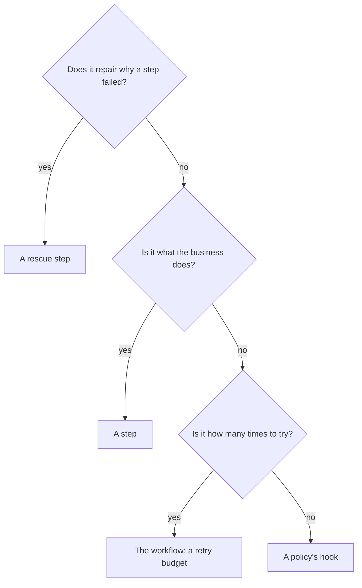

# Step, rescue step or policy?

## What you want to do

Every new decision the shop needs has to live somewhere: whether a card can be charged, what to do when it has expired, when to give up on an order, who audits the charges, how the customer hears about it. You want a way to decide, for each one, whether it belongs in a step, in a rescue step or in a policy, and to recognise the places it does not belong.

## The code

Here is the shop with each of its decisions where it belongs. The table says where, and the code follows.

| Decision | Where it lives | Why there |
|---|---|---|
| Whether the card can be charged, and why not | the `charge` step | it is what the business does with the order |
| A digital order has nothing to ship | the `ship` step, which skips | only the step knows its domain well enough to decide |
| Shipping is tried at most twice | the workflow, as the retry budget of `ship` | how often to try is the plan, not the business rule |
| Fetching the renewed card after an expired card | the rescue step of `charge` | the repair is business work, which only a step does |
| Giving up at once when the payment network is down | the `outage` step policy | it decides what happens next, after an outcome |
| Auditing every successful charge | the `audit` step policy | it reacts to an outcome, and changes nothing in the charge |
| Telling the customer how the order went | the `notify` workflow policy, through a role | it reacts to how the journey ended, and acts on the outside world |

The charge holds the business rule and nothing else. It asks the bank, and reports what happened: success, or a failure with a reason that says why. When the bank cannot be reached at all, the error escapes the step, which is an abnormal termination.

```example
name: ch25_where_it_belongs
region: charge
```

The ship step knows that a digital order has nothing to ship, so it skips, with a reason.

```example
name: ch25_where_it_belongs
region: ship
```

The policies hold the flow decisions. `audit` reacts to every successful charge. `outage` gives up on the order at once when the charge ends in an abnormal termination, with a reason the shop can act on. `notify` tells the customer how the order went, through the shop's `Messages` role.

```example
name: ch25_where_it_belongs
region: policies
```

The workflow puts them together: the steps in order, the retry budget of `ship`, and which policy is attached where.

```example
name: ch25_where_it_belongs
region: workflow
```

Four orders run: one to ship, one digital, one paid with an expired card, and one whose bank is offline.

```example
name: ch25_where_it_belongs
region: run
```

It prints:

```output
name: ch25_where_it_belongs
```

The order paid with an expired card fails, because nothing repairs the card yet. The repair belongs in a rescue step of the charge, which reads why the charge failed, when the charge gave a reason, and, when the card had expired, asks the bank for the renewed one and contributes it.

```example
name: ch25_rescue
region: rescue
```

The workflow attaches it to the charge, which then has no retry budget.

```example
name: ch25_rescue
region: workflow
```

Rescue steps are not in the Rust crate yet, so this example is not compiled, and its syntax may still change before they arrive. A rescue step has a derive and a block of its own: its struct derives `RescueStep`, and its `run` is in a `#[rescue_step]` block. Its fields are its `#[input]` inputs, read from the data bag, any `#[from_rescued_step]` data the failed attempt contributed, the failure's `#[reason]`, an `Option<Reason>` that is `None` after an abnormal termination, and its `#[error]`, an `Option<Error>`. Its `run` returns a `RescueOutcome`, made with `Self::succeed()`, `Self::fail(..)` or `Self::fail_retriably(..)`; there is no skip, so a rescue step that skips cannot be written in Rust. The workflow names it on the step it rescues, with `rescue = RenewCard` in that step's `#[with_step(...)]` line, and the executor names it `charge_rescue`. A `#[with_step]` line that gives both `rescue` and a `retry_budget` does not compile; declared by hand, `build()` reports it as the violation `rescued step retried`.

With the rescue step, the order paid with an expired card succeeds: the charge fails with `expired-card`, the rescue step contributes the renewed card, and the charge runs once more and succeeds. The order whose bank is offline still fails with `payment-network-down`, since `outage` gives up before any rescue. An order whose card is declined fails too, with `nothing-to-renew`: the rescue step is not there to repair a declined card, so it fails, and the journey with it.

Now a counter-example. This charge works, and its journey succeeds, but it repairs the card itself and tells the customer itself.

```example
name: ch25_counter_example
region: step
```

It prints:

```output
name: ch25_counter_example
```

The events say that one attempt of the charge succeeded, and that a key was overwritten. Nothing says the card had expired, that it was renewed, or that the customer was told. To learn that, you would have to read the step.

## How it works

Ask these questions about each decision, in this order. The first answer that fits says where it belongs.



The diagram asks three questions in turn, with four answers:

1. If the decision repairs the cause of a step's failure so that the step can run once more, it belongs in a rescue step.
2. Otherwise, if it is about what the business does, such as charging, reserving or shipping, it belongs in a step.
3. Otherwise, if it says how many times a step is tried, it belongs in the workflow, as the step's retry budget.
4. Otherwise it decides what happens next, or acts on the outside world after an outcome, and it belongs in a hook of a policy.

What each answer gives you:

1. **A step holds one business rule, and says what happened.** A step reports its outcome: success, failure or skipped. A failure carries a reason, which says why, and may say that trying again might help. The step never decides what follows, and it does not need to: the workflow and its policies do. A step may still skip, because it is the only one that knows its domain well enough to say there is nothing to do, as the ship step does for a digital order.
2. **A rescue step repairs, then the step runs once more.** It is a step of its own, run when the step it rescues fails: it reads why the step failed, does the business work that fixes the cause, and contributes what it found. A repair belongs in a rescue step, not in a hook, because it is business work, and hooks only decide what happens next. It belongs there rather than in the step, so that the step stays one business rule and the events show the repair. A rescue step either repairs or fails: one that skips aborts the journey with `rescue skipped`, and some languages do not let you write one at all.
3. **A retry does the same thing again; a rescue fixes something first.** A failure that may go away by itself, such as a busy carrier, wants a retry budget. A failure with a cause that can be fixed, such as an expired card, wants a rescue step. A step has one or the other, never both: a step with a rescue step is never retried.
4. **A policy decides what happens next.** Its hooks are called after a step's outcome or when the journey ends. They may give up, fail the journey or finish it early, and they may act on the outside world through the roles the workflow provides. A hook branches on what the steps reported and contributed; it never makes the business decision itself.
5. **A step reaches no one else.** A step cannot request a role, so the way the workflow offers policies to reach the customer is out of its reach. That is a good sign: telling the customer is not part of charging.

A few counter-examples, each with its place:

1. **A step that retries itself in a loop.** The retries are invisible from outside and have their own limit, hidden in the code. Report a failure that might work next time, and give the step a retry budget in the workflow.
2. **A step that repairs, then tries again inside itself,** as above. The repair leaves no trace in the events, and the step now holds two business rules. Move the repair to a rescue step.
3. **A step that tells the customer.** It mixes a business rule with a reaction to it. Let a policy react, through a role.
4. **A hook that works out the price, or decides whether a card is good enough.** Those are business decisions. Put them in a step, or, for where a step's data comes from, in an input adapter of the workflow.
5. **A hook that wants to skip the next step.** Hooks cannot skip steps. Let the step skip, or let a policy finish the journey from what an earlier step contributed, as [chapter 16](16-ending-a-journey-early.md) shows.
6. **A rescue step for a failure that would go away by itself.** Nothing needs fixing, so there is nothing for it to do. Use a retry budget instead.

## Remember

1. A step holds one business rule and reports what happened, never what to do next.
2. Only a step decides to skip; a hook cannot skip a step, and a rescue step that skips aborts the journey with `rescue skipped`.
3. A repair is business work: it goes in a rescue step, never in a hook, and not inside the step it repairs.
4. A step with a rescue step has no retry budget.
5. How many times a step is tried is in the workflow's declaration; any other decision about what happens next is in a policy's hook.
6. A hook branches on what steps reported and contributed, and acts on the outside world only through roles.
