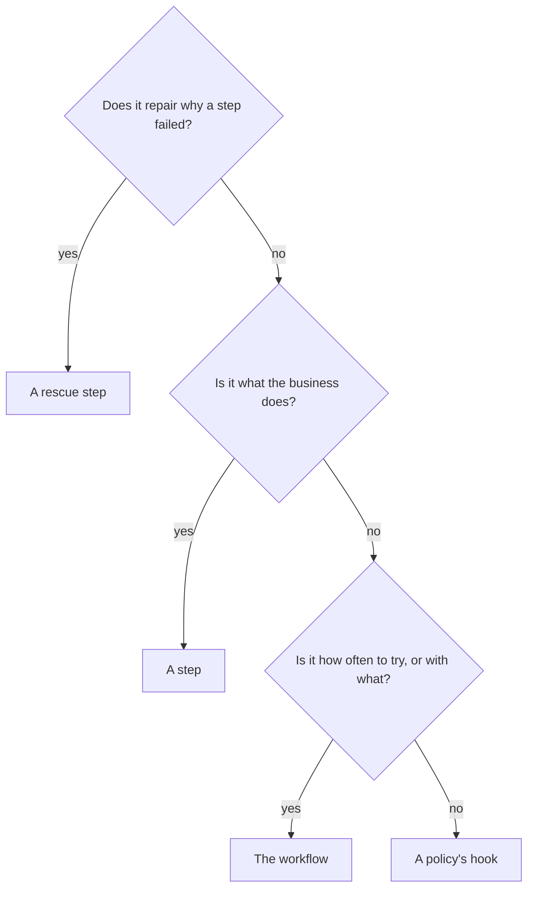

# Deciding where a decision belongs

## What you want to do

The shop will keep gaining rules, and for each new one you want to know where it belongs: in a step, in a rescue step, in the workflow or in a policy. You also want to recognise a rule put in the wrong place, even when it works.

## The code

Every decision the shop has made so far has its place. The workflow's declaration, from [chapter 37](37-mistakes-caught-before-a-journey.md)'s program, names the steps, their policies, the rescue step and the retry budget; the providers and the input adapter are the workflow's methods, from [chapter 13](13-a-carrier-for-each-attempt.md) and [chapter 21](21-deciding-where-a-steps-data-comes-from.md):

```example
name: ch37_listing
region: workflow
```

| Decision | Where it lives | Why there |
|---|---|---|
| Whether the order was already completed | the `lookup` step | reading the order book is the business's work |
| Ending the journey of an order already completed | the `already_completed` policy | it decides what happens after the lookup's outcome |
| The amount, less any discount | the `price` step | it is a rule of the business |
| Whether the card can be charged | the `charge` step | it is what the business does with the order |
| Renewing an expired card | the rescue step, `charge_rescue` | it repairs why the charge failed, so the charge can run once more |
| Giving up a charge that ended in the bank's error | the `outage` policy | it decides what happens after an outcome |
| Writing every charge down | the `audit` policy | it reacts to an outcome, and changes nothing in the charge |
| A gift card has nothing to ship | the `ship` step, which skips | only the step knows its domain well enough |
| Shipping tried twice, with another carrier the second time | the workflow: a retry budget, and a provider for every attempt | how often to try, and with what, is the plan, not the rule |
| Refunding a shipping given up | the `failed_shipping` policy, through a role | it reacts to a step given up, and acts on the outside world |
| Telling the customer | the `notify` policy, through a role | it reacts to how the journey ended |
| The weight out of the warehouse's parcel | the workflow's input adapter | it changes the form of a step's data, and decides nothing |

Now a counter-example. This charge renews an expired card itself, tells the customer, and charges the new card:

```example
name: ch39_counter_example
region: charge
asynchronous: ch39_counter_example_async
```

In the asynchronous form, `Payments` and `Cards` take `#[async_trait]`, and the charge awaits the bank and the registry. It runs Jo's order, and prints:

```output
name: ch39_counter_example
asynchronous: ch39_counter_example_async
```

## How it works

Ask these questions about a new decision, in this order. The first answer that fits says where it belongs.



The diagram asks three questions in turn, with four answers:

1. A decision that repairs why a step failed, so that the step can run once more, belongs in a rescue step.
2. Otherwise, a decision about what the business does, such as pricing, charging or shipping, belongs in a step.
3. Otherwise, how often a step is tried, and which services it gets, belongs in the workflow's declaration.
4. Otherwise, the decision says what happens after an outcome, or acts on the outside world after one, and belongs in a policy's hook.

What the counter-example shows:

1. **It works, and its journey records none of it.** Jo's order is charged and shipped. But the log says the charge succeeded on its first attempt, event 15, and that the card was overwritten, event 17. Nothing says the card had expired, that the registry renewed it, or that Jo was told: the email came from inside the step, as a `println!` the journey never sees.
2. **It holds three decisions where one belongs.** Charging is the step's. Renewing the card is a repair, which the rescue step made visible as `step_rescuing` and `step_rescued` in [chapter 14](14-repairing-then-trying-once-more.md). Telling the customer is a reaction, which belongs to a policy, through a role, as [chapter 19](19-letting-policies-act-on-the-outside-world.md) showed. **A step does one thing of the business, and says how it went.**
3. **The places it doesn't belong are recognisable.** A step that tries its work again in a loop, calls a second service when the first fails, or tells anyone anything has taken a decision that isn't its own. A hook that works out a price, or judges whether a card is good enough, has taken one of the business's.

The shop's decisions now each have their place. But the shop's first checkout, chapter 1's, still runs beside the workflow, and moving a system like it is rarely done in one go.

## Outcomes

We have shown how to place a new decision of the shop, and how to recognise one in the wrong place.

| The usual way | With Itinera |
|---|---|
| A business function often repairs, retries and notifies inside itself, because that is where the problem shows up. | A step does the business's work and says how it went; repairing, retrying and reacting each have a place of their own. |
| A rule put in the wrong place often goes unnoticed, since the code still works. | A rule in the wrong place is spotted from the journey, which records none of what it decided. |
