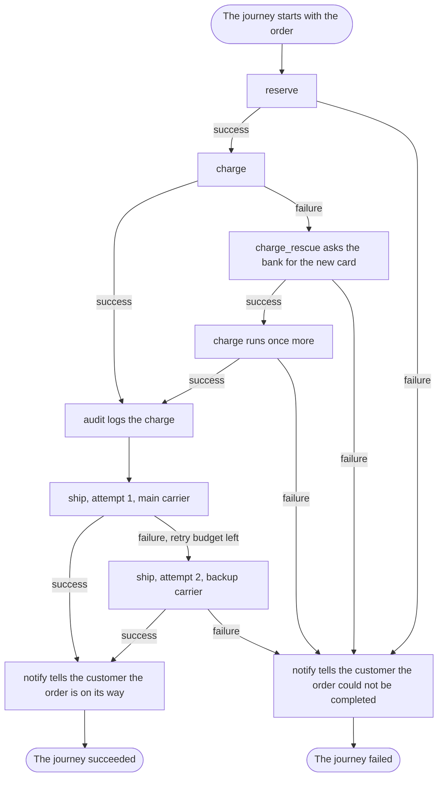

# The big picture

## What you want to do

You want to see [chapter 1](01-but-why-itinera.md)'s checkout written with Itinera, all at once, before learning any of it. Don't try to understand every line. The comments say what each piece is for, and answer chapter 1's questions where the code answers them. The chapters after this one teach each piece, as you need it.

## The code

Start with the workflow. Its decorators tell you at once what happens to every order: which steps run, in what order, how many times, what repairs a failure and who reacts, without reading any of the code they name. Its methods supply what the steps and policies use: the bank, the warehouse and a carrier for every attempt, for the steps, and, for the notify policy, the way the shop tells a customer something.

```example
name: ch02_big_picture
region: workflow
```

The steps reach the bank, the warehouse and the carriers through services: an interface saying what each one does, and a token that stands for the interface while the program runs, which a step names, with a key, to ask for it.

```example
name: ch02_big_picture
region: services
```

The business rules the workflow lists are steps, one for each: reserve the goods, charge the card, renew an expired card, ship the parcel. Each is a class whose constructor takes the data it needs, and whose `run` does the work and says how it went.

```example
name: ch02_big_picture
region: steps
```

The policies the workflow attaches react to how things went: audit a successful charge, tell the customer at the end.

```example
name: ch02_big_picture
region: policies
```

The bank, the warehouse and the carriers are faked, as in chapter 1, so the program prints the same thing every time. Before it runs anything, it prints the workflow's listing:

```example
name: ch02_big_picture
region: list
```

Then it runs seven orders, one journey after another, each an instance of the workflow that the executor runs, and prints how each journey ended. Ann, Ben, Cat and Dan come from chapter 1, with the same data. Three more customers take the paths none of them takes: Eve's goods are out of stock, Fin's card is valid but the order is above the bank's limit of 1,000, and Gil's parcel weighs 60 kg, too heavy for both carriers.

```example
name: ch02_big_picture
region: orders
```

It prints the listing, then, under each order, what the shop's log and the customer were told, and how it ended:

```output
name: ch02_big_picture
```

## How it works

Every order follows the path the diagram draws, and the output shows which.



The diagram shows:

1. The journey starts with the order's data and runs `reserve`. If reserving fails, as Eve's does, the journey goes to its end as failed.
2. Then `charge` runs. When it succeeds, as Ann's does, the `audit` policy logs the charge.
3. When the charge fails, the rescue step, which the listing names `charge_rescue`, runs: for an expired card it asks the bank for the new card, and for any other reason it fails, as Fin's does, and the journey goes to its end as failed.
4. When the rescue succeeds, the charge runs once more. If it succeeds, as Ben's does, `audit` logs it; if it fails, as Dan's does, the journey goes to its end as failed.
5. After the audit, `ship` makes its first attempt, with the main carrier. If it succeeds, as Ann's does, the journey goes to its end as succeeded.
6. If the first attempt fails, `ship` has a retry left, so it makes a second attempt, with the backup carrier. If that succeeds, as Cat's does, the journey goes to its end as succeeded; if it fails, as Gil's does, the journey goes to its end as failed.
7. At a successful end, `notify` tells the customer the order is on its way, and the journey succeeded.
8. At a failed end, `notify` tells the customer the order could not be completed, and the journey failed.

## Outcomes

We have shown the whole checkout as one workflow, where every question of chapter 1 is answered in one place.

| The usual way | With Itinera |
|---|---|
| Retries, repairs and fallbacks usually live in the functions that meet the failure, so finding them means reading those functions. | Every retry budget, rescue step and policy is in the workflow's declaration. |
| Which services a function uses is often known only from its body or its constructor. | The listing shows every step's services and where each comes from, before anything runs. |
