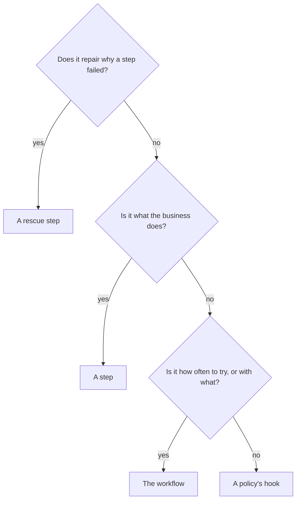

# Deciding where a decision belongs

## What you want to do

The shop will keep gaining rules, and for each new one you want to know where it belongs: in a step, in a rescue step, in the workflow or in a policy.

## The code

Every decision the shop has made so far has its place. The workflow class, as [chapter 37](37-mistakes-caught-before-a-journey.md)'s program has it, names the steps, their policies, the rescue step and the retry budget in its decorators. Its methods are the role implementations of [chapter 19](19-letting-policies-act-on-the-outside-world.md), the ID generator of [chapter 11](11-naming-a-journey.md), the input adapter of [chapter 21](21-deciding-where-a-steps-data-comes-from.md), and the providers of [chapter 7](07-giving-a-step-the-tools-it-needs.md), [chapter 13](13-a-carrier-for-each-attempt.md), [chapter 22](22-finishing-a-journey-early.md) and [chapter 35](35-giving-the-rescue-step-a-service-of-its-own.md):

```example
name: ch37_listing
region: workflow
```

What it names is as earlier chapters show it: the lookup, `AlreadyCompleted`, `OrderBook`, `ORDER_BOOK` and `Ledger` in [chapter 22](22-finishing-a-journey-early.md), the pricing in [chapter 20](20-an-optional-input.md), the charge in [chapter 33](33-giving-every-reporter-what-it-needs.md), `RenewCard`, `Payments`, `Cards`, `CARDS` and `cardRegistry` in [chapter 35](35-giving-the-rescue-step-a-service-of-its-own.md), `Audit` and `Outage` in [chapter 34](34-saying-which-attempt-took-the-money.md), the shipping, `Notify`, `FailedShipping`, `Carrier`, `Messages`, `Refunds` and `network` in [chapter 26](26-running-async-journeys-while-others-wait.md), `Parcel` and `PARCEL` in [chapter 21](21-deciding-where-a-steps-data-comes-from.md), the tokens `PAYMENTS` and `CARRIER` in [chapter 7](07-giving-a-step-the-tools-it-needs.md), the log in [chapter 33](33-giving-every-reporter-what-it-needs.md), [chapter 35](35-giving-the-rescue-step-a-service-of-its-own.md) and [chapter 36](36-orders-refused-before-they-start.md), and the desk in [chapter 11](11-naming-a-journey.md).

| Decision | Where it lives | Why there |
|---|---|---|
| Whether the order was already completed | the `lookup` step | reading the order book is the business's work |
| Ending the journey of an order already completed | the `alreadyCompleted` policy | it decides what happens after the lookup's outcome |
| The amount, less any discount | the `price` step | it is a rule of the business |
| Whether the card can be charged | the `charge` step | it is what the business does with the order |
| Renewing an expired card | the rescue step, `charge_rescue` | it repairs why the charge failed, so the charge can run once more |
| Giving up a charge that ended in the bank's error | the `outage` policy | it decides what happens after an outcome |
| Writing every charge down | the `audit` policy | it reacts to an outcome, and changes nothing in the charge |
| A gift card has nothing to ship | the `ship` step, which skips | only the step knows its domain well enough |
| Shipping tried twice, with another carrier the second time | the workflow: a retry budget, and a provider for every attempt | how often to try, and with what, is the plan, not the rule |
| Refunding a shipping given up | the `failedShipping` policy, through a role | it reacts to a step given up, and acts on the outside world |
| Telling the customer | the `notify` policy, through a role | it reacts to how the journey ended |
| The weight out of the warehouse's parcel | the workflow's input adapter | it changes the form of a step's data, and decides nothing |

## How it works

Ask these questions about a new decision, in this order. The first answer that fits says where it belongs.



The diagram asks three questions in turn, with four answers:

1. A decision that repairs why a step failed, so that the step can run once more, belongs in a rescue step.
2. Otherwise, a decision about what the business does, such as pricing, charging or shipping, belongs in a step.
3. Otherwise, how often a step is tried, and which services it gets, belongs in the workflow: in its decorators, such as `retryBudget`, and in its providers.
4. Otherwise, the decision says what happens after an outcome, or acts on the outside world after one, and belongs in a policy's hook.

Every decision in the table answers one of these questions; the adapter, which decides nothing, only changes the form of a step's data. The workflow class's other methods decide nothing about the flow either: the ID generator names the journey, and the role implementations carry out what a policy decided. **Each place holds one kind of decision, and the journey records each one where it was taken:** a step's outcome, a rescue step's repair, a retry the workflow allows, and the hook a policy ran.

But a rule put in the wrong place often still runs, and nothing in the shop's orders says so.

## Outcomes

We have shown how to place a new decision of the shop.

| The usual way | With Itinera |
|---|---|
| A business function often repairs, retries and notifies inside itself, because that is where the problem shows up. | A step does the business's work and says how it went; repairing, retrying and reacting each have a place of their own. |
